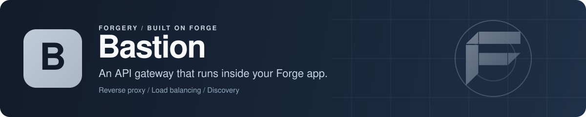

<p align="center">
  
</p>

# Bastion: API gateway for Go and Forge

Bastion is an API gateway and reverse proxy written in Go that runs as an extension inside a [Forge](https://github.com/xraph/forge) app. It proxies HTTP, WebSocket, SSE and gRPC traffic to your upstream services, builds routes from config, from an admin API or from FARP service discovery, and adds load balancing, circuit breakers, retries, health checks, rate limiting, traffic splitting (canary, blue-green, A/B, mirror), authentication, response caching and OpenAPI aggregation. Bastion replaced Forge's old `extensions/gateway` package and lives in its own module.

[](https://go.dev/dl/) [](https://github.com/xraph/bastion/actions/workflows/ci.yml) [](https://pkg.go.dev/github.com/xraph/bastion) [](https://github.com/xraph/bastion/stargazers)

[Documentation](https://www.xraph.com/docs/bastion) · [Quick start](#quick-start) · [Features](#why-bastion) · [Routes](#routes) · [Discovery](#service-discovery-with-farp) · [Admin API](#admin-api) · [Configuration](#configuration) · [FAQ](#faq)

## Quick start

You need [Go 1.26 or later](https://go.dev/dl/).

```bash
go get github.com/xraph/bastion@latest
go get github.com/xraph/forge/extensions/discovery@latest
```

Save this as `main.go`. It sends everything under `/users/` to a service on port 9100:

```go
package main

import (
	"log"

	"github.com/xraph/bastion"
	"github.com/xraph/bastion/gateway"
	"github.com/xraph/forge"
	"github.com/xraph/forge/extensions/discovery"
)

func main() {
	app := forge.NewApp(forge.AppConfig{
		Name:        "edge",
		HTTPAddress: ":8080",
		Extensions: []forge.Extension{
			discovery.NewExtension(discovery.WithBackend("memory")),
			gateway.New(
				bastion.WithRoute(bastion.RouteConfig{
					Path:        "/users/*",
					Targets:     []bastion.TargetConfig{{URL: "http://localhost:9100", Weight: 1}},
					StripPrefix: true,
					Enabled:     true,
				}),
				bastion.WithAdminToken("change-me"),
			),
		},
	})

	if err := app.Run(); err != nil {
		log.Fatal(err)
	}
}
```

Start any HTTP service on port 9100 (`python3 -m http.server 9100` will do), then run the gateway:

```bash
go mod tidy
go run .
```

From another terminal:

```bash
curl -i http://localhost:8080/users/42
# the upstream sees GET /42, and the response carries X-Gateway-Route: manual-/users/*

curl -H "Authorization: Bearer change-me" http://localhost:8080/gateway/api/routes
```

The second call lists the routes the gateway knows about, including your manual one and anything discovery found. Without the token it answers 401.

The gateway lists Forge's `discovery` extension as a dependency, which is why the example registers it with the in-memory backend. Leave it out and Bastion logs a warning and serves only your configured and admin-created routes.

## Why Bastion?

You already run your services on Forge, and the usual next step is putting nginx, Envoy or Kong in front of them, with a second config language and a second deploy. Bastion is the gateway as one more extension in a Forge app, so it uses the same config files, logger, metrics, health checks and container as the services behind it, and you can hook into requests with plain Go functions.

| You need | Bastion gives you |
| --- | --- |
| A reverse proxy for every protocol | HTTP, WebSocket, SSE, gRPC and GraphQL routes, each with path rewriting, prefix stripping and header policies |
| Routes that follow your services | FARP discovery that builds routes from what your services publish, with a prefix per service, plus a push registration endpoint |
| Spreading load | Round robin, weighted round robin, random, least connections and consistent hashing |
| Not hammering a sick upstream | Per-target circuit breakers, active health probes and passive failure tracking |
| Retrying safely | Exponential, linear or fixed backoff with jitter, a retry budget, and retries only on idempotent methods and 502, 503 and 504 by default |
| Releasing gradually | Canary, blue-green, A/B and weighted splits by header, cookie, weight or IP range, plus traffic mirroring |
| Guarding the edge | API key, bearer token, forward auth and JWT providers, IP allow and deny lists, CORS, and TLS or mTLS to upstreams; a WAF ships as a plugin (`security.NewWAFPlugin`) you attach with the `plugin` package |
| Cutting load on upstreams | Token-bucket rate limiting (global, per route, per client) and in-memory response caching |
| One API reference | OpenAPI and AsyncAPI specs fetched from your services and merged into one document |
| Operating it | An admin REST API, a WebSocket event stream, and a contributor for the [Forge dashboard](https://github.com/xraph/forge-dashboard) |

## Routes

A route matches a path (and optionally methods) and sends the request to one or more targets:

```go
bastion.WithRoute(bastion.RouteConfig{
	Path:        "/orders/*",
	Methods:     []string{"GET", "POST"},
	Targets: []bastion.TargetConfig{
		{URL: "http://orders-a:8080", Weight: 3},
		{URL: "http://orders-b:8080", Weight: 1},
	},
	StripPrefix: true,
	Protocol:    bastion.ProtocolHTTP,
	Enabled:     true,
})
```

You set `Protocol` to `ProtocolHTTP`, `ProtocolWebSocket`, `ProtocolSSE`, `ProtocolGRPC` or `ProtocolGraphQL`. If one route needs different behaviour from the rest, you can give it its own `Retry`, `Timeout`, `RateLimit`, `Auth`, `Cache` and `TrafficPolicy`, and you change what the upstream sees with `AddPrefix`, `RewritePath` and `Headers`.

Every proxied response carries an `X-Gateway-Route` header naming the route that matched. Check it first when a request lands somewhere you didn't expect.

Routes come from three places. You write manual routes with `WithRoute`, `WithRoutes` or the `routes` key in your config. Discovery routes come from FARP and get rebuilt on every update. And you or your operators can create routes through the REST API or the dashboard. You can only edit manual and admin-created routes through the admin API, because discovery would overwrite anything you changed on its routes the next time it ran.

## Service discovery with FARP

Turn discovery on and Bastion asks Forge's discovery extension (Consul, etcd, Kubernetes, Eureka, mDNS or memory) for services, then reads the routes each one publishes through [FARP](https://github.com/xraph/farp). By default each service gets the prefix `/{{.ServiceName}}`, which is stripped before the request goes upstream:

```go
discovery.NewExtension(
	discovery.WithBackend("consul"),
	discovery.WithConsul("localhost:8500", ""),
),
gateway.New(
	bastion.WithDiscoveryEnabled(true),
	bastion.WithDiscoveryPrefixTemplate("/api/{{.ServiceName}}"),
),
```

Discovery polls every 30 seconds. You can filter which services become routes with `WithDiscoveryServiceFilters`, rename prefixes with `WithDiscoveryPrefixOverrides`, and keep other Forge extensions' paths out with `WithExtensionFilter`. Services can also push-register themselves at `POST /_farp/v1/register`, with heartbeats at `PUT /_farp/v1/heartbeat/:id`. Those endpoints are mounted with the admin API, so they need `dashboard.enabled`, but they skip the admin auth, because the services calling them have no admin credentials.

If your services publish OpenAPI through FARP, Bastion fetches their specs and merges them into one document at `/gateway/openapi.json`, with per-service specs under `/gateway/api/openapi/services`. Your API consumers get one reference for everything behind the gateway. Turn on `WithOpenAPIRootDocs(true)` if you also want the merged spec at `/openapi.json` and Swagger UI at `/docs`.

These spec endpoints are mounted whenever OpenAPI aggregation is on (`openapi.enabled`, the default), whatever `dashboard.enabled` says. They don't sit behind the admin token or admin middleware either, and that includes `POST /gateway/api/openapi/refresh`, which makes the gateway re-fetch every upstream spec. If your specs aren't public, or you don't want anyone triggering a refresh, put your own guard in front of those paths or turn aggregation off with `WithOpenAPIEnabled(false)`.

## Hooks and auth providers

`Hooks()` gives you `OnRequest`, `OnResponse`, `OnError`, `OnRouteChange`, `OnUpstreamHealth` and `OnCircuitBreak`. The hook engine exists once the app has registered the gateway, so add your hooks in a Forge lifecycle hook:

```go
gw := gateway.New(bastion.WithRoutes(routes))

app := forge.NewApp(forge.AppConfig{Name: "edge", Extensions: []forge.Extension{gw}})

err := app.RegisterHookFn(forge.PhaseAfterRegister, "bastion-hooks", func(ctx context.Context, app forge.App) error {
	gw.Hooks().OnRequest(func(r *http.Request, route *bastion.Route) error {
		r.Header.Set("X-Edge", "bastion")
		return nil
	})
	return nil
})
```

If your `OnRequest` hook returns an error, the request stops there. For gateway-level auth, you register a provider from the `security` package with `gw.Auth().RegisterProvider(...)`: `NewAPIKeyAuthProvider`, `NewBearerTokenAuthProvider`, `NewForwardAuthProvider` or `NewJWTAuthProvider`.

## Persist routes in a database

The `gateway` package keeps admin-created routes in memory, so they're gone after a restart, and it doesn't pull in any database driver. If you want them persisted, use the `extension` package. It's the same gateway plus a store:

```go
import bastionext "github.com/xraph/bastion/extension"

bastionext.New(
	bastion.WithAdminToken(os.Getenv("BASTION_ADMIN_TOKEN")),
).Configure(bastionext.WithGroveDatabase("main"))
```

The store comes from `bastionext.WithStore(s)`, then the named `*grove.DB` from `WithGroveDatabase`, then the default `*grove.DB` in the container. The Grove driver picks the PostgreSQL, SQLite or MongoDB backend, and the store's migrations run at start unless you pass `bastionext.WithDisableMigrate()`. With none of those, the gateway runs in memory. Only the in-memory store has tests today, so check the database backends against a real server before you rely on them.

## Admin API

The admin API is mounted under the dashboard base path, `/gateway` by default:

| Method | Path | What it does |
| --- | --- | --- |
| GET, POST | `/gateway/api/routes` | List routes, or create a manual route |
| GET, PUT, DELETE | `/gateway/api/routes/:id` | Read, update or delete a route |
| POST | `/gateway/api/routes/:id/enable`, `/gateway/api/routes/:id/disable` | Turn a route on or off |
| GET | `/gateway/api/upstreams` | Targets with health and circuit state |
| GET | `/gateway/api/stats`, `/gateway/api/stats/routes` | Gateway and per-route statistics |
| GET | `/gateway/api/config` | The running configuration |
| GET | `/gateway/api/discovery/services` | Services discovery has found |
| POST | `/gateway/api/discovery/refresh` | Re-scan discovery now |
| GET | `/gateway/ws` | Real-time event stream for the dashboard |

Protect it. With `WithAdminToken`, every admin request has to carry `Authorization: Bearer <token>`, and with `WithAdminMiddleware` you can put your own auth in front, such as an [Authsome](https://github.com/xraph/authsome) session check. With neither, Bastion logs a warning at every start, unless you set `WithAllowUnauthenticatedAdmin(true)` because something else guards it.

The `extension` package also registers a contract contributor for the [Forge dashboard](https://github.com/xraph/forge-dashboard), whose `plugin-bastion` package has overview, routes and upstreams pages. [MIGRATION.md](MIGRATION.md) explains what happened to the old Go-rendered dashboard pages.

## Configuration

Bastion reads `extensions.bastion`, or a top-level `bastion` key, from your Forge config files. Anything you leave out keeps its default, and options you pass in code win over the file:

```yaml
extensions:
  bastion:
    enabled: true
    base_path: ""                  # prefix for proxied routes
    routes:
      - path: /users/*
        strip_prefix: true
        enabled: true
        targets:
          - url: http://users:8080
            weight: 1
    load_balancing:
      strategy: leastConnections   # roundRobin, weightedRoundRobin, random, consistentHash
    circuit_breaker:
      enabled: true
      failure_threshold: 5
      reset_timeout: 30s
    retry:
      enabled: true
      max_attempts: 3
    rate_limiting:
      enabled: true
      requests_per_sec: 1000
      burst: 100
      per_client: true
    health_check:
      enabled: true
      interval: 10s
    discovery:
      enabled: true
      prefix_template: "/{{.ServiceName}}"
    dashboard:
      enabled: true                # gates the admin API, the WebSocket hub and the FARP push endpoints
      base_path: /gateway
      admin_token: ""
```

The defaults have discovery, retries, circuit breakers, health checks, metrics, tracing, access logs and the admin API turned on, and rate limiting, caching, auth, CORS, IP filtering and traffic splitting turned off. Every block has a matching option in code: `WithTimeouts`, `WithRetry`, `WithCircuitBreaker`, `WithRateLimiting`, `WithHealthCheck`, `WithLoadBalancing`, `WithAuth`, `WithTLS`, `WithCaching`, `WithCORS`, `WithIPFilter`, `WithOpenAPI`, `WithAsyncAPI`, `WithMetrics`, `WithTracing`, `WithAccessLog`, `WithDashboard` and `WithConfig` for the whole thing.

## Documentation

| If you want to | Read |
| --- | --- |
| Run a first gateway | [Getting started](https://www.xraph.com/docs/bastion/getting-started), [full example](https://www.xraph.com/docs/bastion/guides/full-example) |
| Define routes and upstreams | [Routes](https://www.xraph.com/docs/bastion/concepts/routes), [upstreams](https://www.xraph.com/docs/bastion/concepts/upstreams), [protocols](https://www.xraph.com/docs/bastion/concepts/protocols) |
| Tune resilience | [Load balancing](https://www.xraph.com/docs/bastion/subsystems/load-balancing), [circuit breakers](https://www.xraph.com/docs/bastion/subsystems/circuit-breakers), [health monitoring](https://www.xraph.com/docs/bastion/subsystems/health-monitoring), [rate limiting](https://www.xraph.com/docs/bastion/subsystems/rate-limiting) |
| Ship gradually | [Traffic splitting](https://www.xraph.com/docs/bastion/subsystems/traffic-splitting) |
| Secure the edge | [Authentication](https://www.xraph.com/docs/bastion/subsystems/authentication), [TLS](https://www.xraph.com/docs/bastion/subsystems/tls) |
| Use discovery and merged specs | [Discovery](https://www.xraph.com/docs/bastion/subsystems/discovery), [OpenAPI aggregation](https://www.xraph.com/docs/bastion/guides/openapi-aggregation) |
| Operate it | [Admin API](https://www.xraph.com/docs/bastion/api-reference/admin-api), [dashboard](https://www.xraph.com/docs/bastion/api-reference/dashboard), [hooks](https://www.xraph.com/docs/bastion/guides/hooks) |

The Go API is on [pkg.go.dev](https://pkg.go.dev/github.com/xraph/bastion). New code should import the subpackages (`routing`, `proxy`, `resilience`, `security` and so on) directly; the type aliases in the root package are there for older callers.

## FAQ

### How do I build an API gateway in Go?

Create a Forge app, add `gateway.New` with a `bastion.WithRoute` for each upstream, and run it. The [quick start](#quick-start) is a complete gateway in about thirty lines.

### What happened to Forge's gateway extension?

It moved out of Forge and became Bastion. Swap the import from `github.com/xraph/forge/extensions/gateway` to `github.com/xraph/bastion` (types and options) plus `github.com/xraph/bastion/gateway` or `github.com/xraph/bastion/extension` (the extension itself). The extension registers under the name `bastion` and reads `extensions.bastion` from config.

### Does Bastion proxy WebSockets and gRPC?

Yes. Set `Protocol` on the route to `ProtocolWebSocket`, `ProtocolSSE` or `ProtocolGRPC` (unary and streaming). Buffer sizes and ping intervals for WebSockets live under `WithWebSocket`, and SSE flushing under `WithSSE`.

### How do I do a canary release with Bastion?

Tag the targets on a route (for example `stable` and `canary`), turn on traffic splitting with `TrafficSplit.Enabled` in the config, and give the route a `TrafficPolicy` of type `canary` whose rules send a weight, a header or a cookie to the canary tag.

### Can I use Bastion without service discovery?

Yes. Set `bastion.WithDiscoveryEnabled(false)` and define every route yourself, in code, in config or through the admin API.

## Contributing

Issues and focused pull requests are welcome on [GitHub](https://github.com/xraph/bastion/issues). Everything runs from the repo root:

```bash
GOWORK=off go build ./...
make test          # go test -v ./...
make test-race
make vet
make lint
gofmt -s -w . && goimports -w -local github.com/xraph/bastion .
```

Format with that `goimports` line, not `make fmt`, which groups imports for the wrong module and fails CI's Format job. Tests need nothing beyond Go. `make build`, `make run` and `make dev` point at a `cmd/bastion` that doesn't exist, so skip them. [AGENTS.md](AGENTS.md) explains which packages may import the root, how the extension wires the subsystems, and how releases go out. Commits follow [Conventional Commits](https://www.conventionalcommits.org/).

## License

See the [Bastion repository](https://github.com/xraph/bastion) for license terms.

Bastion is part of the [forgery stack](https://github.com/xraph/forge#the-forgery-stack) built on [Forge](https://github.com/xraph/forge), by [Rex Raphael](https://github.com/juicycleff) and [contributors](https://github.com/xraph/bastion/graphs/contributors).
